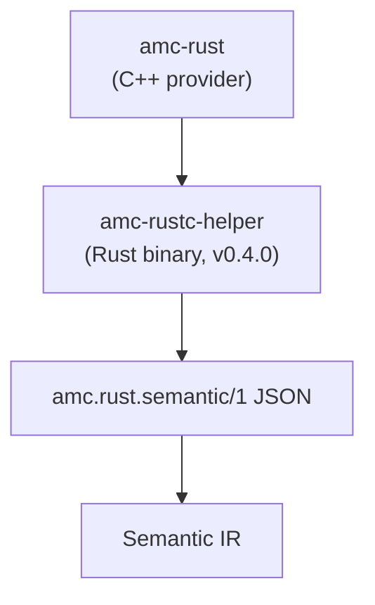

# Rust Semantic Adapter (`amc.rust.semantic/1`)

<p align="center">
  English · <a href="rust-adapter_zh.md">中文</a>
</p>

This document freezes the adapter contract between AMC and the future Rust semantic helper. It is an **internal frontend adapter**, not an ABIX wire format and not a public stable API.



## Why a separate adapter

- `rustc_driver` / `rustc_interface` are compiler-internal and version-coupled.
- AMC must not link `rustc` into its process or expose rustc types.
- v0.3.x only prepares target facts, probes, export handoff and this schema.
- v0.4.0 implements the helper and consumes the schema.

## Versioning

```text
schema: "amc.rust.semantic/1"
```

Rules:

- additive fields are allowed within `/1`;
- a breaking field change bumps the schema version;
- readers ignore unknown optional fields;
- required fields are validated with a clear diagnostic;
- the schema is independent of `.abix` / `.semantic` / `.lowering` versions.

## Document shape

```json
{
  "schema": "amc.rust.semantic/1",
  "producer": {
    "kind": "rustc-helper",
    "version": "0.1.0",
    "rustc": "1.99.1"
  },
  "target": {
    "triple": "x86_64-unknown-linux-gnu",
    "arch": "x86_64",
    "os": "linux",
    "abi": "gnu",
    "pointer_bits": 64,
    "endianness": "little",
    "c_long_bits": 64
  },
  "crate": {
    "name": "demo",
    "edition": "2021",
    "features": ["std"]
  },
  "types": [
    {
      "id": "rust:demo::DemoRect",
      "name": "DemoRect",
      "kind": "record",
      "repr": ["C", "packed(2)"],
      "size": 24,
      "align": 2,
      "fields": [
        {
          "name": "origin",
          "offset": 0,
          "type": "rust:demo::DemoPoint"
        },
        { "name": "width", "offset": 8, "type": "rust:f64" }
      ]
    }
  ],
  "functions": [
    {
      "name": "demo_area",
      "symbol": "demo_area",
      "abi": "C",
      "visibility": "public",
      "return_type": "rust:f64",
      "parameters": [
        {
          "name": "rect",
          "type": "rust:*const demo::DemoRect",
          "mode": "borrowed"
        }
      ]
    }
  ],
  "generics": [],
  "traits": [],
  "errors": [],
  "provenance": {
    "source": "src/lib.rs",
    "rustc": "1.99.1"
  }
}
```

## Field contracts

### `target`

Required for any layout-bearing record. The helper must report the target it compiled for; AMC must not substitute the Host.

### `types`

- `id`: helper-local stable identity, not a Rust `TypeId`.
- `name`: source-level spelling.
- `kind`: `record`, `enum`, `union`, `alias`, `primitive`, `pointer`, `array`.
- `repr`: explicit representation hints (`C`, `transparent`, `packed(N)`, `u8`, ...).
- `size` / `align`: target-specific, from rustc.
- `fields[].offset`: target-specific, from rustc; unions report `0`.

AMC converts these records into Semantic IR and decides whether an entity is ABI-safe. The helper does not decide ABI policy.

### `functions`

- `name` and `symbol` are separate: `#[link_name]` may change the symbol.
- `abi` is the declared ABI (currently `C`); unsupported ABIs are rejected or recorded as non-projectable.
- `visibility` and `source` are provenance, not ABI identity.
- `mode` describes observed ownership (`borrowed`, `owned`, `copy`) only when the helper can prove it; absence means unspecified.
- Only explicitly selected functions are exported.

### `generics` / `traits`

Optional and additive. v0.4 may populate declarations, bounds, associated types and explicit instances. AMC must not assume that a missing entry means “not generic”; absence means “not selected/proven”.

### `errors`

Optional. `Result<T,E>` and error enums may be described as semantic entities; the ABI mapping is done by AMC's error pass, not by the helper.

### `provenance`

Debug and reproducibility only. It never participates in ABI identity or compatibility.

## Rules

1. No rustc HIR/THIR/MIR pointers, spans or internal IDs cross the adapter.
2. No pointer values or in-memory layouts from the helper process.
3. The helper is target-specific; cross-target requires a target-specific run.
4. The helper does not choose ABI contracts, ownership modes or codegen.
5. AMC validates the schema before importing.
6. Unknown optional fields are ignored; unknown required fields fail.
7. The adapter is not installed as a public ABIX contract.

## v0.3.x / v0.4.0

```text
v0.3.x  schema frozen; probe and TargetFacts validate the same fields
v0.4.0  amc-rustc-helper implements the producer side
```

v0.3.x does not implement the helper. It only:

- defines this schema;
- validates target facts and layout probes;
- implements explicit `[[rust.expose]]` / `extern "C"` handoff, including generated `#[no_mangle] pub extern "C"` wrappers for ordinary Rust functions;
- keeps `parser + probe` as the fallback path.

## Related documents

- [Module boundaries](module-boundaries.md)
- [Rust provider](../lang/rust.md)
- [Benchmarks](../bench/README.md)
