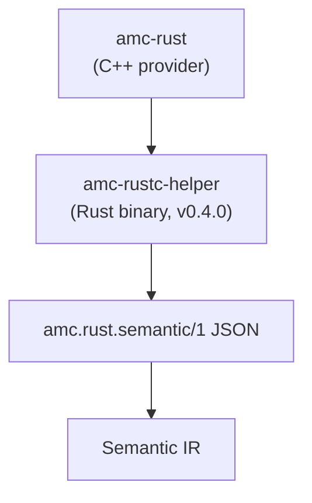

# Rust Semantic Adapter (`amc.rust.semantic/1`)

<p align="center">
  English · <a href="rust-adapter_zh.md">中文</a>
</p>

This document freezes the adapter contract between AMC and the future Rust semantic helper. It is an **internal frontend adapter**, not an ABIX wire format and not a public stable API.



## Why a separate adapter

- `rustc_driver` / `rustc_interface` are compiler-internal and version-coupled.
- AMC must not link `rustc` into its process or expose rustc types.
- v0.3.x only prepares target facts, probes, export handoff and this schema.
- v0.4.0 implements the helper and consumes the schema.

## Versioning

```text
schema: "amc.rust.semantic/1"
```

Rules:

- additive fields are allowed within `/1`;
- a breaking field change bumps the schema version;
- readers ignore unknown optional fields;
- required fields are validated with a clear diagnostic;
- the schema is independent of `.abix` / `.semantic` / `.lowering` versions.

## Document shape

```json
{
  "schema": "amc.rust.semantic/1",
  "producer": {
    "kind": "rustc-helper",
    "version": "0.1.0",
    "rustc": "1.99.1"
  },
  "target": {
    "triple": "x86_64-unknown-linux-gnu",
    "arch": "x86_64",
    "os": "linux",
    "abi": "gnu",
    "pointer_bits": 64,
    "endianness": "little",
    "c_long_bits": 64
  },
  "crate": {
    "name": "demo",
    "edition": "2021",
    "features": ["std"]
  },
  "cargo": {
    "package_id": "path+file:///workspace/app#demo@0.2.0",
    "manifest_path": "/workspace/app/Cargo.toml",
    "workspace_root": "/workspace",
    "target_directory": "/workspace/target",
    "workspace_members": [
      "path+file:///workspace/core#demo_core@0.1.0",
      "path+file:///workspace/app#demo@0.2.0"
    ],
    "default_members": ["path+file:///workspace/app#demo@0.2.0"],
    "dependencies": [
      {
        "name": "demo_core",
        "requirement": "*",
        "kind": "normal",
        "optional": false,
        "path": "/workspace/core"
      }
    ]
  },
  "types": [
    {
      "id": "rust:demo::DemoRect",
      "name": "DemoRect",
      "kind": "record",
      "repr": ["C", "packed(2)"],
      "size": 24,
      "align": 2,
      "fields": [
        {
          "name": "origin",
          "offset": 0,
          "type": "rust:demo::DemoPoint"
        },
        { "name": "width", "offset": 8, "type": "rust:f64" }
      ]
    }
  ],
  "functions": [
    {
      "name": "demo_area",
      "symbol": "demo_area",
      "abi": "C",
      "visibility": "public",
      "return_type": "rust:f64",
      "parameters": [
        {
          "name": "rect",
          "type": "rust:*const demo::DemoRect",
          "mode": "borrowed"
        }
      ]
    }
  ],
  "generics": [],
  "traits": [],
  "errors": [],
  "lifetimes": [],
  "trait_objects": [],
  "async_functions": [],
  "provenance": {
    "source": "src/lib.rs",
    "rustc": "1.99.1"
  }
}
```

## Field contracts

### `target`

Required for any layout-bearing record. The helper must report the target it compiled for; AMC must not substitute the Host.

### `cargo`

Present when a Cargo manifest is available. `package_id`, `manifest_path`, `workspace_root` and `target_directory` identify the selected package and build layout. `workspace_members` and `default_members` list package IDs; `dependencies[]` records `name`, `requirement`, `kind` (`normal` / `dev` / `build`), `optional` and an optional `path`. Workspace facts are language/build metadata; they never enter ABI identity.

### `types`

- `id`: helper-local stable identity, not a Rust `TypeId`.
- `name`: source-level spelling, including the module path (`nested::Point`).
- `path`: the same module-qualified spelling.
- `kind`: `record`, `enum`, `union`, `alias`, `primitive`, `pointer`, `array`.
- `repr`: explicit representation hints (`C`, `transparent`, `packed(N)`, `align(N)`, `u8`, ...).
- `size` / `align`: target-specific, from rustc.
- `generic`: true for a generic declaration whose layout is not concrete.
- `underlying`: for an alias, the referenced type identity; otherwise `null`.
- `fields[].offset`: target-specific, from rustc; unions report `0`.
- `variants[]`: enum variants with `name`, `discriminant` (decimal string) and `payload` type identities.

Concrete generic instances are emitted as ordinary `record` / `union` / `enum` entries with a spelled identity such as `rust:demo::Wrapper<i32>`. A generic declaration keeps `size = 0` and `align = 1`; AMC must skip it when importing layout-bearing entities and use the concrete instance instead.

AMC converts these records into Semantic IR and decides whether an entity is ABI-safe. The helper does not decide ABI policy.

### `functions`

- `name` and `symbol` are separate: `#[link_name]` may change the symbol.
- `path` is the module-qualified source path; `name` is the unqualified name.
- `abi` is the declared ABI (currently `C`); unsupported ABIs are rejected or recorded as non-projectable.
- `visibility` and `source` are provenance, not ABI identity.
- `kind`: `free`, `associated` or `method`; `has_receiver` distinguishes methods.
- `owner`: for associated functions, the self type identity; otherwise `null`.
- `mode` describes observed ownership (`borrowed`, `owned`, `copy`) only when the helper can prove it; absence means unspecified.
- Only explicitly selected functions are exported.

### `generics`

Each entry describes one declaration:

```json
{
  "id": "rust:demo::Wrapper",
  "name": "Wrapper",
  "path": "Wrapper",
  "kind": "type",
  "parameters": [{ "index": 0, "name": "T", "kind": "type", "default": null }],
  "where_clause": ["T: core::marker::Copy"],
  "instances": ["rust:demo::Wrapper<i32>"]
}
```

`parameters[].kind` is `type`, `const` or `lifetime`. `instances` names concrete type entries emitted elsewhere in the document; it is not a request to monomorphize anything.

### `traits`

Trait declarations and impls share the array and are distinguished by `kind`:

- `trait`: `parameters`, `where_clause`, `supertraits`, `associated_types[]` and `methods[]`; each method carries `name`, `path`, `has_receiver`, `required`, `abi`, `return_type` and `parameters`.
- `impl`: `self_type`, `trait` (or `null`), `negative`, `parameters`, `where_clause` and `methods[]`.

AMC records these as language metadata. It does not run a trait solver and does not assume that a missing entry means “not a trait”.

### `errors`

`errors[]` describes `Result<T, E>` error types observed in function signatures:

```json
{
  "id": "rust:demo::DemoError",
  "name": "DemoError",
  "kind": "enum",
  "variants": [
    { "name": "InvalidInput", "discriminant": "1", "payload": null }
  ],
  "functions": ["rust:demo::demo_try"]
}
```

The helper only describes the semantic entity. The ABI status mapping remains in AMC's error pass and requires the explicit `[[error]]` contract.

### `lifetimes`

`lifetimes[]` records lifetime parameters, outlives clauses and the late-bound count of a function. Lifetimes are language metadata; they never become ABI fields:

```json
{ "owner": "rust:demo::Holder", "name": "'a", "kind": "param", "bounds": [] }
```

### `trait_objects`

`trait_objects[]` records `dyn Trait` occurrences found in fields, parameters, returns or aliases. The entry names the owner, context, full type spelling and the trait bounds. Trait objects are not ABI-projectable without an explicit contract; the helper only preserves the semantic fact.

### `async_functions`

`async_functions[]` records async functions with their path, name and return type. Async is semantic metadata; AMC does not map it to a direct C ABI call.

### Explicit generic instances

`--instantiate Template=arg1,arg2` is repeatable. AMC forwards each `[[instantiate]]` entry to the helper, which emits the concrete local generic instance (primitive arguments only) even if the source never references it. This is the explicit-selection path; the helper does not enumerate all monomorphizations.

### `.semantic` Rust extension

AMC copies `cargo`, `generics`, `traits`, `errors`, `lifetimes`, `trait_objects` and `async_functions` into the semantic sidecar under `"rust"`. ABIX-compatible types/functions still go through the ABI and lowering views; language-only facts stay in this extension.

### `provenance`

Debug and reproducibility only. It never participates in ABI identity or compatibility.

## Rules

1. No rustc HIR/THIR/MIR pointers, spans or internal IDs cross the adapter.
2. No pointer values or in-memory layouts from the helper process.
3. The helper is target-specific; cross-target requires a target-specific run.
4. The helper does not choose ABI contracts, ownership modes or codegen.
5. AMC validates the schema before importing.
6. Unknown optional fields are ignored; unknown required fields fail.
7. The adapter is not installed as a public ABIX contract.

## v0.3.x / v0.4.0

```text
v0.3.x  schema frozen; probe and TargetFacts validate the same fields
v0.4.0  amc-rustc-helper producer: target/crate envelope, types, functions,
        generics, traits and errors
```

The v0.4.0 helper implements the process boundary with `rustc_driver`, emits the `target` / `crate` / `provenance` envelope, walks all free items including nested modules, and extracts `repr` records, concrete generic instances, public `extern "C"` functions, impl methods, generic declarations, traits/impls and `Result` error enums. It also reads workspace facts from `cargo metadata` when a manifest is available. The helper is a Cargo project under `tools/rustc-helper/` and is built with `rustc-dev`; `build.rs` supplies the sysroot search paths and rpath.

`amc-rust` invokes it through `[rust] helper`, imports the helper's types and functions into ABIX/Semantic IR, cross-checks their layouts against the source parser, and writes the semantic sidecar. The parser/probe remains the fallback when the helper is unavailable; parser errors for syntax the helper already proved are downgraded to warnings.

v0.3.x did not implement the helper. It only:

- defines this schema;
- validates target facts and layout probes;
- implements explicit `[[rust.expose]]` / `extern "C"` handoff, including generated `#[no_mangle] pub extern "C"` wrappers for ordinary Rust functions;
- keeps `parser + probe` as the fallback path.

## Related documents

- [Module boundaries](module-boundaries.md)
- [Rust provider](../lang/rust.md)
- [Benchmarks](../bench/README.md)
