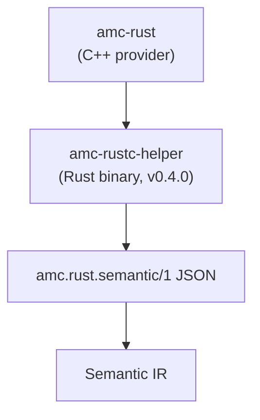

# Rust Semantic Adapter（`amc.rust.semantic/1`）

<p align="center">
  中文 · <a href="rust-adapter.md">English</a>
</p>

本文冻结 AMC 与未来 Rust semantic helper 之间的 adapter 契约。它是**内部前端 adapter**，不是 ABIX wire format，也不是公共稳定 API。



## 为什么需要独立 adapter

- `rustc_driver` / `rustc_interface` 是编译器内部接口，和 Rust 版本强绑定；
- AMC 不能把 rustc 链进自己的进程，也不能暴露 rustc 类型；
- v0.3.x 只准备 target facts、probe、导出交接和这份 schema；
- v0.4.0 实现 helper 并消费该 schema。

## 版本

```text
schema: "amc.rust.semantic/1"
```

规则：

- `/1` 内允许 additive 字段；
- 破坏性字段变化提升 schema 版本；
- reader 忽略未知可选字段；
- required 字段校验失败时给出明确诊断；
- schema 与 `.abix` / `.semantic` / `.lowering` 版本独立。

## 文档结构

```json
{
  "schema": "amc.rust.semantic/1",
  "producer": {
    "kind": "rustc-helper",
    "version": "0.1.0",
    "rustc": "1.99.1"
  },
  "target": {
    "triple": "x86_64-unknown-linux-gnu",
    "arch": "x86_64",
    "os": "linux",
    "abi": "gnu",
    "pointer_bits": 64,
    "endianness": "little",
    "c_long_bits": 64
  },
  "crate": {
    "name": "demo",
    "edition": "2021",
    "features": ["std"]
  },
  "types": [
    {
      "id": "rust:demo::DemoRect",
      "name": "DemoRect",
      "kind": "record",
      "repr": ["C", "packed(2)"],
      "size": 24,
      "align": 2,
      "fields": [
        {
          "name": "origin",
          "offset": 0,
          "type": "rust:demo::DemoPoint"
        },
        { "name": "width", "offset": 8, "type": "rust:f64" }
      ]
    }
  ],
  "functions": [
    {
      "name": "demo_area",
      "symbol": "demo_area",
      "abi": "C",
      "visibility": "public",
      "return_type": "rust:f64",
      "parameters": [
        {
          "name": "rect",
          "type": "rust:*const demo::DemoRect",
          "mode": "borrowed"
        }
      ]
    }
  ],
  "generics": [],
  "traits": [],
  "errors": [],
  "provenance": {
    "source": "src/lib.rs",
    "rustc": "1.99.1"
  }
}
```

## 字段契约

### `target`

任何带布局的 record 都必须有 target。helper 必须报告它实际编译的 target； AMC 不得用 Host 替代。

### `types`

- `id`：helper 内部稳定身份，不是 Rust `TypeId`；
- `name`：源码拼写；
- `kind`：`record`、`enum`、`union`、`alias`、`primitive`、`pointer`、`array`；
- `repr`：显式 representation hints（`C`、`transparent`、`packed(N)`、`u8` 等）；
- `size` / `align`：target-specific，来自 rustc；
- `fields[].offset`：target-specific，来自 rustc；union 字段 offset 为 0。

AMC 将这些记录转换为 Semantic IR，并决定实体是否 ABI-safe。helper 不决定 ABI 策略。

### `functions`

- `name` 与 `symbol` 分离：`#[link_name]` 可能改变 symbol；
- `abi`：声明的 ABI（当前为 `C`）；不支持的 ABI 明确拒绝或标记不可投影；
- `visibility` / `source` 只是 provenance，不是 ABI identity；
- `mode` 只在 helper 能证明时描述 `borrowed` / `owned` / `copy`；缺失表示未指定；
- 只有显式选择的函数才导出。

### `generics` / `traits`

可选、additive。v0.4 可以填充声明、bounds、associated types 和显式实例。 AMC 不能假设“缺失 = 不存在”；缺失只表示“未选择/未证明”。

### `errors`

可选。`Result<T,E>` 和 error enum 可以描述为语义实体；ABI 映射由 AMC 的 error pass 完成，不由 helper 决定。

### `provenance`

只用于调试和可复现性，不参与 ABI identity 或 compatibility。

## 规则

1. 不跨 adapter 传递 rustc HIR/THIR/MIR 指针、span 或内部 ID；
2. 不传递 helper 进程内的指针值或内存布局；
3. helper 是 target-specific 的；cross-target 必须重新运行；
4. helper 不选择 ABI 契约、ownership mode 或 codegen；
5. AMC 导入前必须校验 schema；
6. 未知可选字段忽略；未知 required 字段失败；
7. adapter 不作为公共 ABIX 契约安装。

## v0.3.x / v0.4.0

```text
v0.3.x  冻结 schema；probe 和 TargetFacts 验证相同字段
v0.4.0  amc-rustc-helper 实现 producer 侧
```

v0.3.x 不实现 helper，只做：

- schema 定义；
- target facts / layout probe 验证；
- 显式 `[[rust.expose]]` / `extern "C"` 交接；
- parser + probe fallback。

## 相关文档

- [模块边界](module-boundaries_zh.md)
- [Rust provider](../lang/rust_zh.md)
- [基准测试](../bench/README_ZH.md)
