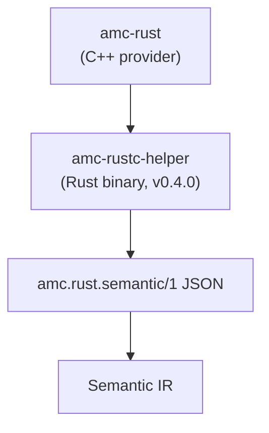

# Rust Semantic Adapter（`amc.rust.semantic/1`）

<p align="center">
  中文 · <a href="rust-adapter.md">English</a>
</p>

本文冻结 AMC 与未来 Rust semantic helper 之间的 adapter 契约。它是**内部前端 adapter**，不是 ABIX wire format，也不是公共稳定 API。



## 为什么需要独立 adapter

- `rustc_driver` / `rustc_interface` 是编译器内部接口，和 Rust 版本强绑定；
- AMC 不能把 rustc 链进自己的进程，也不能暴露 rustc 类型；
- v0.3.x 只准备 target facts、probe、导出交接和这份 schema；
- v0.4.0 实现 helper 并消费该 schema。

## 版本

```text
schema: "amc.rust.semantic/1"
```

规则：

- `/1` 内允许 additive 字段；
- 破坏性字段变化提升 schema 版本；
- reader 忽略未知可选字段；
- required 字段校验失败时给出明确诊断；
- schema 与 `.abix` / `.semantic` / `.lowering` 版本独立。

## 文档结构

```json
{
  "schema": "amc.rust.semantic/1",
  "producer": {
    "kind": "rustc-helper",
    "version": "0.1.0",
    "rustc": "1.99.1"
  },
  "target": {
    "triple": "x86_64-unknown-linux-gnu",
    "arch": "x86_64",
    "os": "linux",
    "abi": "gnu",
    "pointer_bits": 64,
    "endianness": "little",
    "c_long_bits": 64
  },
  "crate": {
    "name": "demo",
    "edition": "2021",
    "features": ["std"]
  },
  "types": [
    {
      "id": "rust:demo::DemoRect",
      "name": "DemoRect",
      "kind": "record",
      "repr": ["C", "packed(2)"],
      "size": 24,
      "align": 2,
      "fields": [
        {
          "name": "origin",
          "offset": 0,
          "type": "rust:demo::DemoPoint"
        },
        { "name": "width", "offset": 8, "type": "rust:f64" }
      ]
    }
  ],
  "functions": [
    {
      "name": "demo_area",
      "symbol": "demo_area",
      "abi": "C",
      "visibility": "public",
      "return_type": "rust:f64",
      "parameters": [
        {
          "name": "rect",
          "type": "rust:*const demo::DemoRect",
          "mode": "borrowed"
        }
      ]
    }
  ],
  "generics": [],
  "traits": [],
  "errors": [],
  "provenance": {
    "source": "src/lib.rs",
    "rustc": "1.99.1"
  }
}
```

## 字段契约

### `target`

任何带布局的 record 都必须有 target。helper 必须报告它实际编译的 target； AMC 不得用 Host 替代。

### `types`

- `id`：helper 内部稳定身份，不是 Rust `TypeId`；
- `name`：源码拼写，包含模块路径（`nested::Point`）；
- `path`：同一模块限定拼写；
- `kind`：`record`、`enum`、`union`、`alias`、`primitive`、`pointer`、`array`；
- `repr`：显式 representation hints（`C`、`transparent`、`packed(N)`、`align(N)`、`u8` 等）；
- `size` / `align`：target-specific，来自 rustc；
- `generic`：true 表示布局尚未具体化的泛型声明；
- `underlying`：alias 的被引用类型身份，其他情况为 `null`；
- `fields[].offset`：target-specific，来自 rustc；union 字段 offset 为 0；
- `variants[]`：enum variant 的 `name`、`discriminant`（十进制字符串）和 `payload` 类型身份。

具体泛型实例以普通 `record` / `union` / `enum` 条目输出，身份形如 `rust:demo::Wrapper<i32>`。泛型声明保持 `size = 0`、`align = 1`；AMC 导入布局实体时必须跳过声明并使用具体实例。

AMC 将这些记录转换为 Semantic IR，并决定实体是否 ABI-safe。helper 不决定 ABI 策略。

### `functions`

- `name` 与 `symbol` 分离：`#[link_name]` 可能改变 symbol；
- `path` 是模块限定源码路径，`name` 是非限定名；
- `abi`：声明的 ABI（当前为 `C`）；不支持的 ABI 明确拒绝或标记不可投影；
- `visibility` / `source` 只是 provenance，不是 ABI identity；
- `kind`：`free`、`associated` 或 `method`；`has_receiver` 区分方法；
- `owner`：关联函数的 self type 身份，否则为 `null`；
- `mode` 只在 helper 能证明时描述 `borrowed` / `owned` / `copy`；缺失表示未指定；
- 只有显式选择的函数才导出。

### `generics`

每个条目描述一个声明：

```json
{
  "id": "rust:demo::Wrapper",
  "name": "Wrapper",
  "path": "Wrapper",
  "kind": "type",
  "parameters": [{ "index": 0, "name": "T", "kind": "type", "default": null }],
  "where_clause": ["T: core::marker::Copy"],
  "instances": ["rust:demo::Wrapper<i32>"]
}
```

`parameters[].kind` 为 `type`、`const` 或 `lifetime`。`instances` 指向文档中其他位置的具体类型条目，不表示要求 helper 主动单态化。

### `traits`

trait 声明和 impl 共用数组，通过 `kind` 区分：

- `trait`：`parameters`、`where_clause`、`supertraits`、`associated_types[]` 和 `methods[]`；method 包含 `name`、`path`、`has_receiver`、`required`、`abi`、`return_type` 和 `parameters`；
- `impl`：`self_type`、`trait`（或 `null`）、`negative`、`parameters`、`where_clause` 和 `methods[]`。

AMC 将这些作为语言元数据保留，不运行 trait solver，也不假设“缺失 = 不是 trait”。

### `errors`

`errors[]` 描述函数签名中观察到的 `Result<T, E>` 错误类型：

```json
{
  "id": "rust:demo::DemoError",
  "name": "DemoError",
  "kind": "enum",
  "variants": [
    { "name": "InvalidInput", "discriminant": "1", "payload": null }
  ],
  "functions": ["rust:demo::demo_try"]
}
```

helper 只描述语义实体；ABI status 映射仍由 AMC 的 error pass 和显式 `[[error]]` 契约完成。

### `provenance`

只用于调试和可复现性，不参与 ABI identity 或 compatibility。

## 规则

1. 不跨 adapter 传递 rustc HIR/THIR/MIR 指针、span 或内部 ID；
2. 不传递 helper 进程内的指针值或内存布局；
3. helper 是 target-specific 的；cross-target 必须重新运行；
4. helper 不选择 ABI 契约、ownership mode 或 codegen；
5. AMC 导入前必须校验 schema；
6. 未知可选字段忽略；未知 required 字段失败；
7. adapter 不作为公共 ABIX 契约安装。

## v0.3.x / v0.4.0

```text
v0.3.x  冻结 schema；probe 和 TargetFacts 验证相同字段
v0.4.0  amc-rustc-helper 输出 target/crate envelope、types、functions、
        generics、traits 和 errors
```

v0.4.0 的 helper 用 `rustc_driver` 实现进程边界，输出 `target` / `crate` / `provenance` envelope，遍历所有 free items（含嵌套 module），并提取 `repr` 记录、具体泛型实例、public `extern "C"` 函数、impl 方法、泛型声明、 traits/impls 和 `Result` error enum。存在 manifest 时还会读取 `cargo metadata` 的 workspace 事实。helper 是 `tools/rustc-helper/` 下的 Cargo 项目，构建需要 `rustc-dev`；`build.rs` 负责 sysroot 搜索路径和 rpath。

`amc-rust` 通过 `[rust] helper` 调用它，将 helper 的 types/functions 导入 ABIX/Semantic IR，与源码 parser 交叉校验布局，并写出 semantic sidecar。 helper 不可用时 parser/probe 仍是回退路径；helper 已证明的语法如果 parser 无法建模，parser 错误会降级为 warning。

v0.3.x 不实现 helper，只做：

- schema 定义；
- target facts / layout probe 验证；
- 显式 `[[rust.expose]]` / `extern "C"` 交接；
- parser + probe fallback。

## 相关文档

- [模块边界](module-boundaries_zh.md)
- [Rust provider](../lang/rust_zh.md)
- [基准测试](../bench/README_ZH.md)
